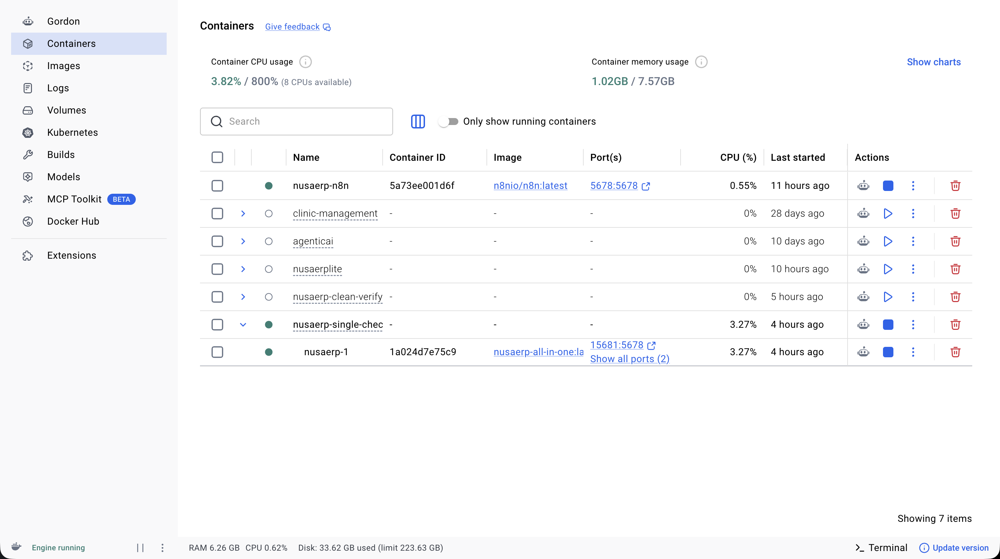
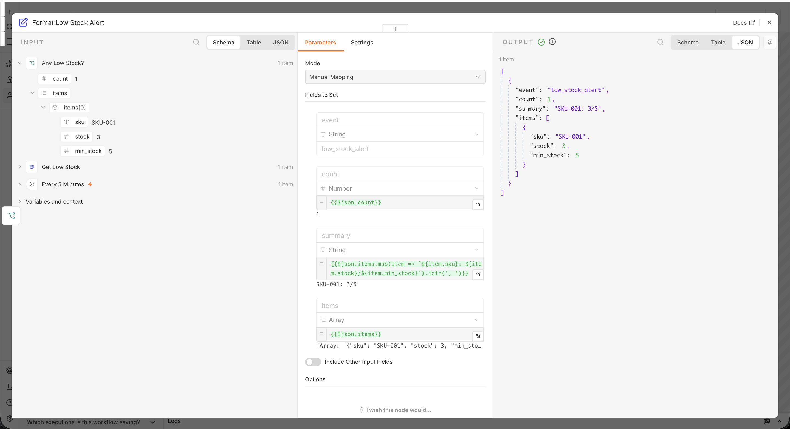
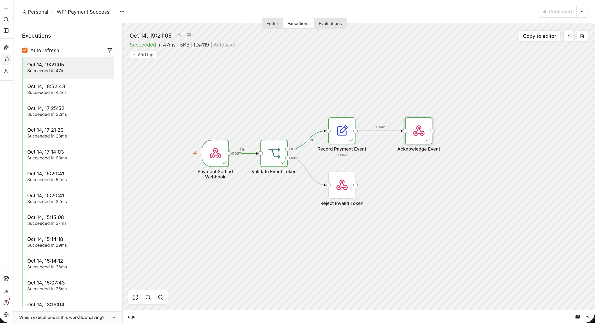
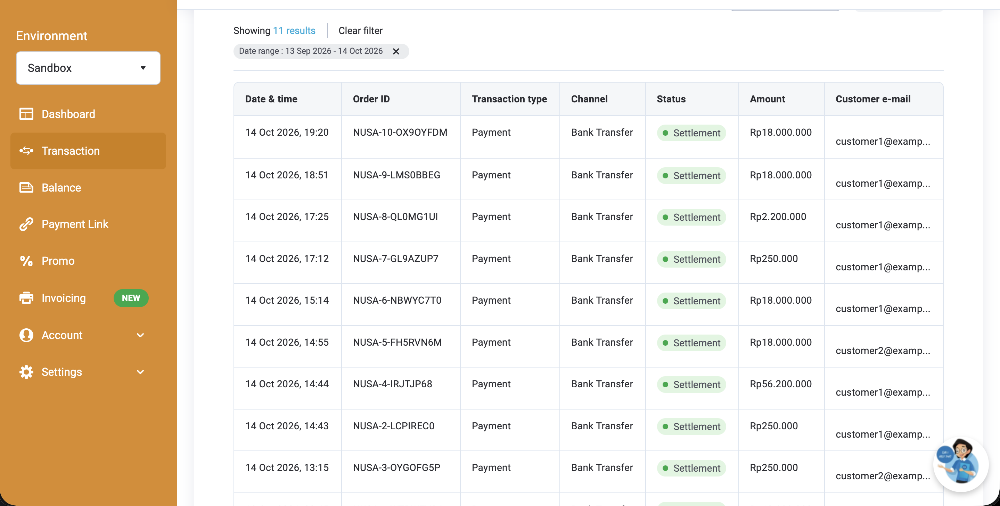
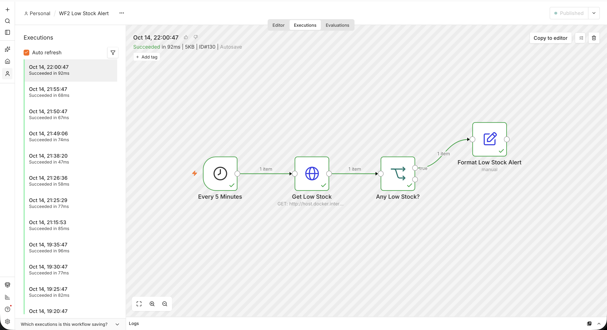
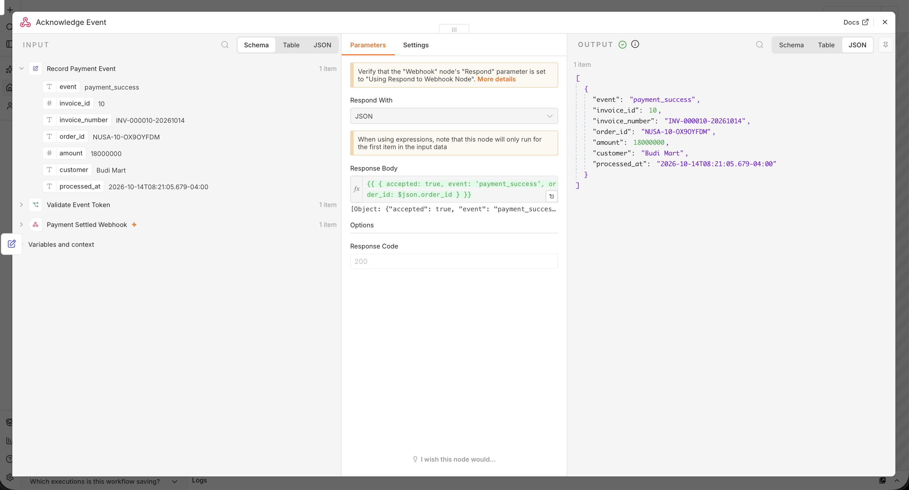
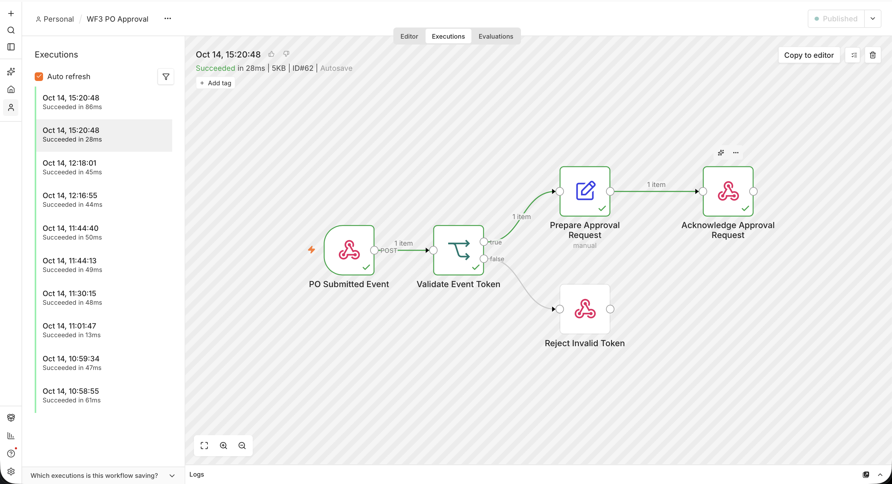
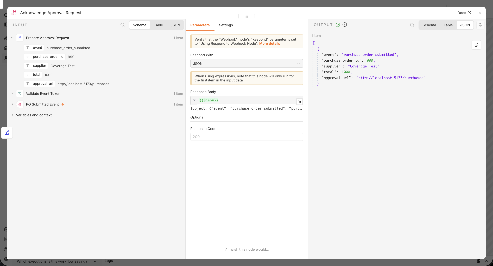

# NusaERP Lite

Mini ERP untuk penjualan, persediaan, dan purchasing. Backend Laravel menyediakan REST API dan business rules; React mengonsumsi API tersebut; PostgreSQL menyimpan data operasional; n8n menerima event dan menjalankan pemeriksaan low-stock terjadwal.

## Status Fitur

| Area | Status | Catatan |
| --- | --- | --- |
| Auth | Terintegrasi | Sanctum login/logout, akun demo, role admin/sales/gudang. Akses API dibatasi role. |
| Master data | Terintegrasi | CRUD produk, customer, supplier; penghapusan ditolak bila data memiliki histori. |
| Sales | Terintegrasi sebagian | Buat order, invoice, Snap checkout, daftar order/status invoice, bayar ulang. Belum ada edit/hapus order atau cetak invoice. |
| Midtrans | Terintegrasi sebagian | Membuat transaksi Sandbox dan memvalidasi signature/amount callback. Settlement publik memerlukan tunnel HTTPS dan belum dites dengan callback nyata. |
| Inventory | Terintegrasi | CRUD produk, movement history, adjustment masuk/keluar yang diaudit dengan proteksi stok negatif. Belum mendukung multi-gudang. |
| Purchasing | Terintegrasi sebagian | Buat/submit, daftar status, approve, receive; transisi status tervalidasi dan stok masuk idempoten. Belum ada edit/hapus draft atau PDF. |
| Dashboard | Terintegrasi sebagian | KPI, chart tujuh hari kalender dengan nilai nol, dan kurs IDR/USD dari Frankfurter. |
| n8n | Terintegrasi sebagian | Laravel mengirim event pembayaran/PO; low-stock workflow polling tiap 5 menit dan menyiapkan ringkasan. WF3 memberi link ke Purchasing; admin tetap menyetujui dari UI ERP. Belum ada kanal pesan email/Telegram/Sheets. |
| Docker Compose | Runtime terverifikasi | Stack berjalan dari image build dengan named volumes baru; backend memakai konfigurasi PostgreSQL service dan endpoint low-stock dapat diakses dari n8n. |

## Arsitektur

```text
React SPA --REST/Sanctum--> Laravel API --SQL--> PostgreSQL
                                  |  ^
                                  |  +-- Midtrans notification (signature-verified)
                                  +----> n8n webhooks / scheduled API polling
                                  +----> Frankfurter exchange-rate API
```

React menangani antarmuka dan memanggil REST API Laravel. Laravel mengelola autentikasi, validasi, dan alur bisnis; PostgreSQL menyimpan data ERP. Integrasi Midtrans mengirim notifikasi pembayaran ke Laravel, sedangkan Laravel meneruskan event ke n8n atau menyediakan endpoint yang dipolling workflow. Frankfurter digunakan untuk mengambil kurs mata uang. Pada mode Docker Compose, tiap komponen berjalan sebagai service terpisah di jaringan Compose.

## Stack

- Frontend: React 19, Vite, TypeScript, TanStack Query, Axios, Recharts
- Backend: Laravel 13, Sanctum, PHP 8.4
- Database: PostgreSQL 16 (Compose); PostgreSQL lokal juga didukung
- Automation: n8n workflow exports

## Prasyarat

- Docker Desktop/Engine untuk menjalankan semua service melalui Compose
- Node.js dan npm untuk frontend lokal
- PHP 8.4+, Composer, PostgreSQL, dan ekstensi `pdo_pgsql` untuk backend lokal

## Menjalankan dengan Docker Compose

Mode ini direkomendasikan untuk development lokal. Docker Compose membangun frontend dan backend, lalu menjalankan PostgreSQL dan n8n sebagai service. Pastikan Docker Desktop (macOS/Windows) atau Docker Engine beserta plugin Compose (Linux) sudah berjalan.

1. Clone repository dan masuk ke folder proyek:
   ```bash
   git clone https://github.com/OrewaKimi/NusaERP.git NusaERPLite
   cd NusaERPLite
   ```
2. Buat konfigurasi environment lokal dari contoh:
   ```bash
   cp .env.example .env
   ```
   Nilai default pada `.env` cukup untuk menjalankan demo lokal. Isi `MIDTRANS_SERVER_KEY` dan `MIDTRANS_CLIENT_KEY` dengan key Sandbox jika ingin mencoba checkout; jangan masukkan key asli ke Git. Port dapat diubah melalui `POSTGRES_PORT`, `BACKEND_PORT`, `FRONTEND_PORT`, dan `N8N_PORT`.
3. Build image dan jalankan semua service di background:
   ```bash
   docker compose up --build -d
   ```
   Pada startup, backend menjalankan migrasi dan seeder secara otomatis. Tunggu sampai service siap, lalu periksa status:
   ```bash
   docker compose ps
   docker compose logs -f backend
   ```
   Tekan `Ctrl+C` untuk keluar dari tampilan log; container tetap berjalan.
4. Buka aplikasi:

   | Komponen | URL |
   | --- | --- |
   | ERP frontend | http://localhost:5173 |
   | Laravel API | http://localhost:8000 |
   | n8n editor | http://localhost:5678 |

5. Login dengan salah satu akun demo pada bagian [Akun Demo dan Role](#akun-demo-dan-role). Untuk mengaktifkan automasi, import file JSON dari `n8n/workflows` melalui editor n8n. Aktifkan WF1/WF3 untuk menerima event dan WF2 untuk polling terjadwal. Nilai `NUSAERP_AUTOMATION_TOKEN` di n8n harus sama dengan `AUTOMATION_TOKEN` backend; konfigurasi contoh sudah menyamakan keduanya.

### Perintah CLI Docker

Jalankan perintah berikut dari direktori root repository:

```bash
# Jalankan service satu per satu (Compose ikut menyalakan dependency yang diperlukan)
docker compose up --build -d backend
docker compose up --build -d frontend
docker compose up -d n8n

# Lihat service dan statusnya
docker compose ps

# Ikuti log semua service, atau batasi ke satu service (contoh: backend)
docker compose logs -f
docker compose logs -f backend

# Jalankan perintah Artisan di container backend
docker compose exec backend php artisan about
docker compose exec backend php artisan migrate:status

# Rebuild image setelah mengubah Dockerfile atau dependency
docker compose up --build -d

# Hentikan container; named volumes dan data tetap disimpan
docker compose down

# Hentikan container sekaligus hapus seluruh data database dan n8n
docker compose down -v
```

Gunakan `docker compose down -v` hanya jika memang ingin menghapus data lokal. Volume `postgres_data` dan `n8n_data` akan tetap ada setelah `docker compose down` biasa.

Data PostgreSQL dan konfigurasi/workflow n8n disimpan pada named volumes `postgres_data` dan `n8n_data`.

Setelah service berjalan, buka frontend di `http://localhost:5173`, API backend di `http://localhost:8000`, dan editor n8n di `http://localhost:5678`. Perintah startup di atas bisa dijalankan berurutan dari terminal yang sama.

#### Cloudflare Quick Tunnel untuk Midtrans

Tunnel bersifat opsional dan diperlukan agar Midtrans dapat mengirim notification webhook ke backend lokal. Pasang `cloudflared` terlebih dahulu, lalu jalankan perintah berikut di terminal terpisah ketika backend sudah aktif:

```bash
cloudflared tunnel --url http://127.0.0.1:8000
```

Salin URL HTTPS `trycloudflare.com` yang muncul, lalu atur **Payment Notification URL** di dashboard Midtrans Sandbox menjadi `https://<hostname-trycloudflare>/api/payments/midtrans/notification`. Biarkan terminal tunnel tetap berjalan selama pengujian. URL Quick Tunnel berubah saat tunnel dimulai ulang; rincian instalasi dan Named Tunnel ada di [panduan Cloudflare Tunnel untuk Midtrans](docs/cloudflare-tunnel-midtrans.md).

### Satu Container

Mode ini opsional dan mengemas PostgreSQL, backend, frontend, n8n, serta Cloudflare Tunnel dalam satu container. Untuk menjalankan demo lokal:

```bash
cp .env.single.example .env.single
# Edit .env.single dan ganti password serta token contoh sebelum digunakan.
docker compose -f docker-compose.single.yml --env-file .env.single up --build -d
docker compose -f docker-compose.single.yml --env-file .env.single ps
docker compose -f docker-compose.single.yml --env-file .env.single logs -f nusaerp
```

ERP tersedia di `http://localhost:8080` dan n8n di `http://localhost:5678`. Volume `nusaerp_all_data` menyimpan data secara persisten. Untuk menghentikan mode ini, jalankan `docker compose -f docker-compose.single.yml --env-file .env.single down`. Rincian environment, Cloudflare Tunnel, dan deployment tersedia di [panduan single-container](docs/single-container.md).

## Menjalankan backend lokal

1. Buat database PostgreSQL bernama `nusaerp` dan siapkan role yang dapat mengaksesnya.
2. Siapkan backend:
   ```bash
   cd backend
   cp .env.example .env
   composer install
   ```
3. Sesuaikan `DB_CONNECTION=pgsql`, `DB_HOST`, `DB_PORT`, `DB_DATABASE`, `DB_USERNAME`, dan `DB_PASSWORD` pada `backend/.env`.
4. Jalankan migrasi, demo data, dan API:
   ```bash
   php artisan migrate --seed
   php artisan serve --host=127.0.0.1 --port=8000
   ```
5. Di terminal lain, jalankan frontend:
   ```bash
   cd frontend
   npm install
   npm run dev -- --host 127.0.0.1 --port 5173
   ```

## Akun Demo dan Role

- `admin@nusaerp.test` / `password`: seluruh modul dan approval PO
- `sales@nusaerp.test` / `password`: customer dan sales
- `gudang@nusaerp.test` / `password`: inventory, supplier, dan purchasing

## Midtrans Sandbox

Isi `MIDTRANS_SERVER_KEY` dan `MIDTRANS_CLIENT_KEY` pada environment backend (Compose memakai root `.env`; lokal memakai `backend/.env`). Jangan commit file `.env` atau key asli. Endpoint `POST /api/invoices/{id}/pay` membuat Snap checkout.

Untuk callback, set Notification URL dashboard Midtrans ke `https://<public-host>/api/payments/midtrans/notification`, lalu arahkan tunnel HTTPS ke backend port 8000. Callback settlement harus melewati signature dan amount validation sebelum invoice paid dan stok berkurang. Return URL checkout kembali ke halaman Sales; redirect kembali bukan bukti pembayaran.

Panduan langkah demi langkah Cloudflare Quick Tunnel dan Named Tunnel, konfigurasi URL notifikasi Sandbox, uji koneksi, troubleshooting, dan keamanan tersedia di [docs/cloudflare-tunnel-midtrans.md](docs/cloudflare-tunnel-midtrans.md).

## Workflow n8n

- `wf1-payment-success.json`: menerima event settlement Laravel, memvalidasi shared token, mencatat event pada execution n8n, lalu memberi acknowledgment.
- `wf2-low-stock-alert.json`: polling endpoint low-stock setiap lima menit dan menyusun ringkasan item stok rendah.
- `wf3-po-approval.json`: menerima event PO submitted dengan shared token dan menyusun informasi permintaan approval. Approval tetap dilakukan user berwenang melalui endpoint ERP.

Email, Telegram, dan Google Sheets belum dikonfigurasi. Tambahkan node dan credentials kanal tersebut sebelum menganggap notifikasi eksternal aktif. Workflow diekspor dalam repository, tetapi perlu diimpor/diaktifkan di instance n8n.

Untuk menjalankan image n8n secara mandiri lewat Docker Desktop dan mengimpor workflow, ikuti [docs/n8n-docker-desktop.md](docs/n8n-docker-desktop.md).

## Dokumentasi Visual

Screenshot berikut merekam hasil pengujian lokal dan Sandbox. Data transaksi serta payload workflow yang terlihat adalah data demo.

### Docker Desktop



Docker Desktop memperlihatkan service n8n dan container NusaERP single-container dalam keadaan berjalan. Port yang dipublikasikan dapat digunakan untuk membuka editor n8n dan aplikasi ERP dari browser.

### Midtrans Sandbox



Dashboard Sandbox menampilkan transaksi NusaERP dengan status `Settlement`, termasuk order `NUSA-10-OX9OYFDM`. Ini merupakan bukti pembayaran uji di lingkungan Sandbox, bukan transaksi uang sungguhan.

### Workflow n8n

#### WF1: Payment Success



Webhook pembayaran melewati validasi token, mencatat event, lalu mengirim acknowledgment. Jalur validasi token tidak valid diarahkan ke node penolakan.



Output menunjukkan event `payment_success` beserta nomor invoice, order, nominal, dan customer yang diproses.

#### WF2: Low Stock Alert



Trigger berjalan setiap lima menit, mengambil data stok rendah dari API backend, dan meneruskan hasil jika ditemukan produk di bawah batas minimum.



Contoh output menandai `SKU-001` dengan stok 3 dan minimum 5, lalu menyusun ringkasan alert. Workflow saat ini menyiapkan data; pengiriman ke email atau Telegram belum dikonfigurasi.

#### WF3: PO Approval



Event PO yang dikirim Laravel divalidasi menggunakan shared token, disiapkan sebagai permintaan approval, dan mendapatkan acknowledgment. Token tidak valid mengikuti jalur penolakan.



Output memuat event `purchase_order_submitted`, supplier, total, dan tautan menuju halaman Purchasing. Approval akhir tetap dilakukan oleh pengguna berwenang di ERP.

## Endpoint Utama

- Auth: `POST /api/login`, `POST /api/logout`, `GET /api/me`
- Master data: `/api/customers`, `/api/suppliers`, `/api/products`
- Movement: `GET /api/products/{id}/movements`, `POST /api/products/{id}/adjust-stock`
- Sales/payment: `/api/sales-orders`, `POST /api/invoices/{id}/pay`, `POST /api/payments/midtrans/notification`
- Purchasing: `/api/purchase-orders`, `POST /api/purchase-orders/{id}/submit|approve|receive`
- Dashboard/external: `/api/dashboard/summary`, `/api/dashboard/sales-chart`, `/api/external/exchange-rate?to=USD`
- Automation: `GET /api/automation/low-stock`, `POST /api/automation/po/{id}/approve` (header `X-Automation-Token`)

## Validasi Terakhir

- Automation dan purchase-order feature tests: 8 test, 23 assertion lulus dengan SQLite in-memory.
- Frontend production build berhasil; Vite masih memberi warning ukuran chunk di atas 500 kB.
- Compose dijalankan pada project terisolasi dengan PostgreSQL volume baru; PostgreSQL sehat, backend `/up`, frontend, dan n8n `/healthz` merespons.
- Request dari container n8n ke backend low-stock mendapat HTTP 200 dan mengembalikan produk seeder `SKU-002` (stok 4, minimum 5). Screenshot di atas menunjukkan WF2 telah dipublikasikan dan berhasil berjalan pada instance pengujian; pada instance baru, workflow export tetap perlu diimpor dan diaktifkan. Pengiriman pesan eksternal belum dikonfigurasi.
- Image single-container berhasil dibangun dan dijalankan dengan volume persisten; ERP `/up`, n8n `/healthz`, login demo, dan endpoint low-stock lulus. Cloudflare Tunnel binary tersedia; koneksi tunnel belum diuji karena token Cloudflare belum diberikan.
